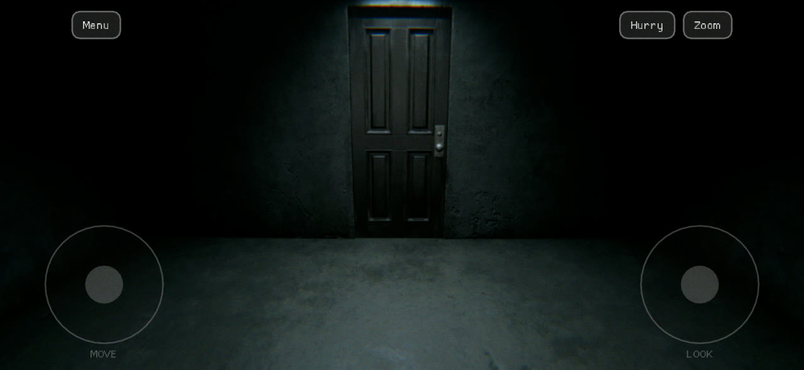
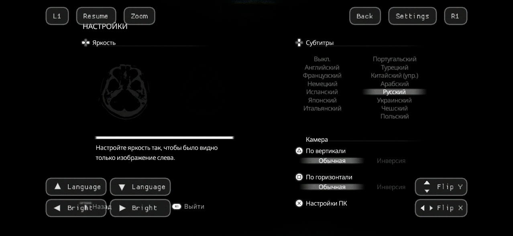
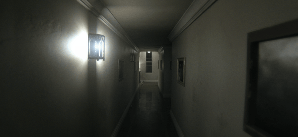

# P.T. for iOS

This is the iPhone and iPad build of [LoreanXavier's native P.T. port](https://github.com/LoreanXavier/pt-pc), the
2014 PS4 teaser by Kojima Productions rebuilt in C++ on Vulkan. It is not an emulator: every level, model, texture,
sound, script and cutscene is read at run time from your own copy of the PS4 game. There is no game data in this
repository and none in the app.

The game itself, its engine (Hallway Engine) and almost all of the code are LoreanXavier's; this fork adds what an iOS
device needs on top of the current upstream release (1.0.5). If the port is worth something to you, support its author:
[ko-fi.com/loreanxavier](https://ko-fi.com/loreanxavier).

It plays the whole teaser, from the first wake-up to the street, with the voice part included.

## What you need

- Your own copy of P.T., the US release CUSA01127, as a dump folder from your console (or extracted from a fake PKG on a
  PC with the upstream setup). A store PKG cannot be used: it is encrypted for the console that owns it.
- An iPhone or iPad with iOS 16.4 or newer. It is tested on an iPhone 15 (A16). Vulkan runs through MoltenVK on Metal;
  the game's BC textures are decoded on the CPU for the GPUs that cannot sample them, so any recent A-series or M-series
  device runs it.
- A Mac with Xcode to build and sign the app (there is no App Store or prebuilt signed release).
- A microphone for one part of the game, as on the PS4, or the on-screen Jack button in its place.

## Installing

1. Build the app (see Building) and install it with your own Apple ID: Xcode's automatic signing, or
   `xcrun devicectl device install app --device <id> build/ios/Release-iphoneos/pt.app`. A free Apple ID's signature
   lasts 7 days; the first time, trust your developer certificate under Settings > General > VPN & Device Management.
   The CI workflow (.github/workflows/ios.yml) also makes an unsigned IPA for sideloading tools.
2. Put the game data in the app's Documents as `CUSA01127/` with `chunk1.psarc`, `texture.qar` and
   `pathid_list_ps4.bin` (and `sce_sys/`): through the Files app (On My iPhone > P.T.), or from the Mac with
   `xcrun devicectl device copy to --device <id> --domain-type appDataContainer --domain-identifier <bundle id> ...`.
   About 1.2 GB.
3. Start P.T. from the home screen.

Settings, saves and the log (`pt.log`) are in the app's own data.

## Playing

Touch: the MOVE and LOOK sticks appear under your thumbs in the bottom corners. Menu is top left; Zoom, Hurry and,
where the game takes them, Use (the picture loop) and Jack (the last loop, in place of saying the word) are top right.
In the menus the buttons follow a pad: L1, Resume and Zoom along the top left, Back, Settings and R1 along the top
right, language and brightness (or the directions) bottom left, the camera inversion bottom right. The controls keep
clear of the notch, the Dynamic Island and the home indicator.

*The touch controls in play and in the original options, captured on an iPhone 15.*

Gamepad: any controller iOS knows works as the PS4 pad, with the original's prompts and vibration. Whatever was used
last rules: pressing a button or moving a stick on the pad hides the touch controls, touching the screen brings them back.
Clicking the left stick (L3) hurries until you click it again or stop.

## What is different on iOS

- Display: no window modes or sizes; PC settings > Display > Render scale (50 to 100 %, 67 % by default) is the share of
  the screen's resolution the game draws at, applied at the next start. HDR works on an EDR screen.
- Upscaling: Apple MetalFX (Quality to Ultra performance) instead of FSR, DLSS and XeSS. On an A16 MetalFX itself costs
  about 10 ms a frame, so it pays off only at the lower steps.
- Hurry (Fast Walk, PC settings > Extras) is on by default: walk 50 % faster with the Hurry button, L3, or Shift.
- Shadows are capped at 1024 px tiles; texture levels over 512 px are left out where the textures are decoded on the
  CPU.
- Not in the iOS build: ray-traced effects (MoltenVK has no ray queries), enhanced textures (Real-ESRGAN), frame
  generation, VR, and the iOS Simulator (MoltenVK's iOS release has
  no simulator slice).

*The hallway on an iPhone 15 (A16), rendered on the phone at 67 % of its screen.*

Performance on an iPhone 15 (60 Hz screen, v-sync on, so frame rates step through 60, 30 and 20): the original preset at
67 % without an upscaler draws in about 26 to 30 ms on the GPU, MetalFX at Ultra performance about 24 ms, which holds
30 fps. A warm phone throttles its GPU; the log names the device's thermal state at start.

Everything else, from the original's options to photo mode, the museum, the loop browser, Game+, the speedrun timer and
the added languages, is the upstream game: see [the upstream README](https://github.com/LoreanXavier/pt-pc#readme).

## Building

On a Mac with Xcode: `brew install cmake ninja shaderc vulkan-headers`, and the dynamic MoltenVK.framework for iOS from
the official `MoltenVK-ios.tar` (KhronosGroup/MoltenVK releases). Then

    tar -xf MoltenVK-ios.tar
    VULKAN_SDK_IOS=$PWD/MoltenVK/MoltenVK cmake -S . -B build/ios -G Xcode -DCMAKE_TOOLCHAIN_FILE=cmake/iOS.cmake \
        -DPT_IOS_BUNDLE_ID=<your.bundle.id> -DVulkan_INCLUDE_DIR=/opt/homebrew/include \
        -DVulkan_LIBRARY=$PWD/MoltenVK/MoltenVK/dynamic/MoltenVK.xcframework/ios-arm64/MoltenVK.framework/MoltenVK \
        -DVulkan_GLSLC_EXECUTABLE=/opt/homebrew/bin/glslc
    cmake --build build/ios --config Release --target pt -- -sdk iphoneos -allowProvisioningUpdates \
        CODE_SIGNING_ALLOWED=YES CODE_SIGN_STYLE=Automatic DEVELOPMENT_TEAM=<your team id>

gives `build/ios/Release-iphoneos/pt.app`. CMake fetches the other dependencies as for the desktop builds. More in
IOS_PORT.md. The Windows, Linux and macOS builds of this tree work as upstream's do.

## Thanks

- LoreanXavier for the P.T. PC port this is built on, and everyone credited in it.
- anch-dev for the first iOS port.
- Felipe de Lima (ignusloki/pt-pc) for Fast Walk, and the Android launcher whose touch layout the iOS controls follow.
- ginnfx and ahm3texe for Apple MetalFX and the MoltenVK lighting fix, by way of upstream.
- MoltenVK (Apache-2.0) and bcdec by Sergii Kudlai (MIT or Unlicense), beside the upstream libraries; their notices are
  in `licenses/` in the app.

P.T. is the work of Kojima Productions and is owned by Konami. This project is not affiliated with, endorsed by or
connected to either of them. It contains none of their assets and does nothing without your own copy of the game.

## License

The port's own code is under the MIT license (see LICENSE). The third-party pieces keep their own licenses.

## AI Disclosure

From upstream: AI coding tools were used in developing and debugging the port. The project uses the original game assets
from the player's own PS4 copy. Optional enhanced textures (not on iOS) use machine-learning upscaling on existing
textures.
